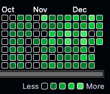

# ✦ Grit (git2grit)

*Git on TUI steroids with OCD. The ultimate AI-powered Git companion for streak-obsessed developers.*

[](https://python.org)
[](LICENSE)
[](https://github.com/hammaadworks/grit)

<p align="center">
  
</p>

---

Grit is a high-fidelity terminal interface designed for developers who demand both intelligence and aesthetics in their workflow. Built with **Pydantic AI** and **Rich**, it transforms the often-tedious process of committing, branching, and maintaining streaks into an elite experience.

### 🔥 Experience the Difference

| Boring Git Status | Grit Intelligence Dashboard |
| :--- | :--- |
| `git status` | `grit status` |
|  |  |

> [!TIP]
> Just want the TUI and AI without the history manipulation? Set `target = 0` in `grit config` to enable **Safe Mode**.

## ✨ Core Capabilities

- **🤖 CommitScribe AI**: Interactive TUI for staging files with deep-diff analysis powered by Pydantic AI. Automatically generates professional, context-aware commit messages.
- **📅 Real-Time Reallocation**: Intelligently shifts commit dates as you code to ensure your streak never breaks (when `target > 0`).
- **📊 Intelligence Dashboard**: A high-fidelity web-based dashboard for visualizing metrics, velocity, and streak health.
- **🔄 Historical Spread**: Use `grit spread` to redistribute commits across historical gaps and fill in the blanks.
- **🛠️ Interactive Control Center**: Manage AI providers (Gemini, OpenAI, Ollama) and allocation strategies through a beautiful TUI.

## 🚀 Getting Started

### Installation

Grit is best installed using `uv` for a seamless experience:

```bash
uv tool install git2grit
```

Alternatively, via pip:

```bash
pip install git2grit
```

### First Steps

1. **Initialize Configuration**: Run the interactive setup to configure your AI provider and targets.
   ```bash
   grit config
   ```
2. **Check Your Status**: View your current streak and commit intelligence.
   ```bash
   grit status
   ```
3. **Make Your First AI Commit**:
   ```bash
   grit commit
   ```

## 🛠 Commands at a Glance

| Command | Description |
| :--- | :--- |
| `grit commit` | Elite TUI + AI commit wizard with staging picker. |
| `grit status` | Check metrics, velocity, and streak health. |
| `grit branch` | Unified context & Worktree manager. |
| `grit dash` | Launch the web-based intelligence dashboard. |
| `grit spread` | Redistribute work across historical gaps. |
| `grit config` | Interactive setup for AI and allocation logic. |

> [!WARNING]
> **History Manipulation**: Grit modifies `GIT_AUTHOR_DATE` and `GIT_COMMITTER_DATE`. While powerful for streak protection, use with caution on shared repositories as it rewrites history.

---

**Built with ❤️ by [hammaadworks](https://github.com/hammaadworks)**

*Disclaimer: Reflect your real work, don't fake it. Use your powers for good.*
